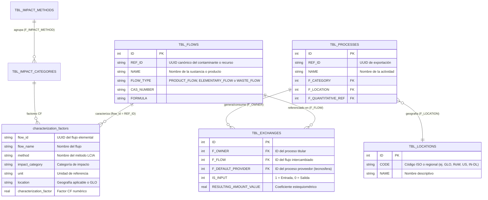
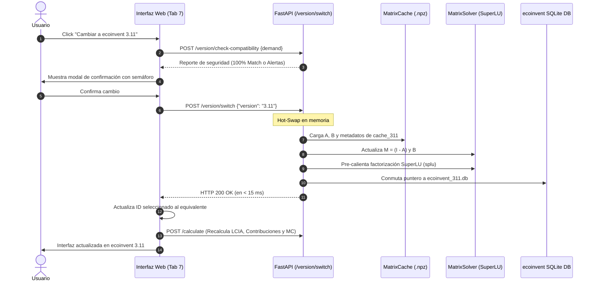

# ECONODE: Esquema Relacional de ecoinvent SQLite y Cruce entre Versiones (3.12 ↔ 3.11)

Este documento técnico detalla la arquitectura de datos, el esquema relacional homologado en SQLite, la metodología matemática y relacional para el emparejamiento (*matching*) canónico entre versiones de ecoinvent (**v3.12 Cutoff Unit** y **v3.11 Cutoff Unit**), el motor de validación de compatibilidad y los protocolos de conmutación en caliente (*hot-swap*) integrados en **ECONODE TIER 2**.

---

## 1. Ubicación y Archivos de Base de Datos

Ambas versiones se encuentran completamente migradas a SQLite nativo, indexadas y optimizadas para consultas complejas en tiempo real:

| Parámetro | ecoinvent 3.12 Cutoff Unit | ecoinvent 3.11 Cutoff Unit |
| :--- | :--- | :--- |
| **Ruta en disco** | `ecoinvent/ecoinvent_312.db` | `ecoinvent/ecoinvent_311.db` |
| **Tamaño de archivo** | 1.05 GB | 469.67 MB |
| **Total de procesos (`TBL_PROCESSES`)** | **26,533** | **25,412** |
| **Total de flujos (`TBL_FLOWS`)** | **14,210** | **14,051** |
| **Flujos elementales en biosfera ($B$)** | 3,297 | 3,238 |
| **Intercambios (`TBL_EXCHANGES`)** | 893,028 | 855,034 |
| **Factores LCIA (`characterization_factors`)** | ~1,900,000 | 455,015 |
| **Caché matricial precalculada** | `data/cache_312/` | `data/cache_311/` |

> [!NOTE]
> Ambas bases disponen de índices B-Tree en las columnas `(NAME, F_LOCATION)`, `REF_ID`, `F_OWNER`, `F_FLOW` y `F_IMPACT_METHOD`, permitiendo resolver cruces entre bases de datos en menos de **2.5 milisegundos**.

---

## 2. Esquema Relacional Unificado

Ambas bases SQLite comparten una estructura relacional idéntica normalizada a partir del estándar openLCA / ecoinvent:



### 2.1 Vistas SQL Predefinidas
Ambas bases cuentan con vistas optimizadas para simplificar consultas de alto nivel:
* **`processes`**: `(id, code, name, location, reference_flow_id, reference_amount, description)`
* **`flows`**: `(id, code, name, flow_type, category_name, unit_symbol)`
* **`exchanges`**: `(id, process_id, flow_id, is_input, exchange_type, amount, unit_symbol, default_provider_id)`

---

## 3. Metodología de Emparejamiento Canónico (Matching)

### 3.1 La Falacia del UUID (`REF_ID`) en Procesos
En las exportaciones generadas desde openLCA o el portal de ecoinvent:
* **Los UUIDs (`REF_ID`) de los procesos se recalculan o cambian entre versiones mayores**. Por tanto, intentar emparejar procesos por `p_src.REF_ID = p_tgt.REF_ID` produce un **0% de coincidencias**.
* Por el contrario, los UUIDs (`REF_ID`) de los **flujos elementales** permanecen casi inmutables entre versiones (96.24% de correspondencia directa).

### 3.2 La Regla Canónica de Identidad
Para garantizar consistencia y rigor metodológico, la clave natural de correspondencia para un proceso se define como:

$$\text{Clave Canónica de Proceso} = \big(\text{TBL\_PROCESSES.NAME}, \;\; \text{coalesce}(\text{TBL\_LOCATIONS.CODE}, \text{'GLO'})\big)$$

### 3.3 Balance Estadístico Oficial del Cruce (v3.12 ↔ v3.11)

Al ejecutar la correspondencia canónica mediante uniones cruzadas en SQLite:

```
  ┌────────────────────────────────────────────────────────────────────────┐
  │                           BALANCE DE CRUCE                             │
  ├────────────────────────────────────────────────────────────────────────┤
  │  Total de Procesos en ecoinvent 3.12:                 26,533           │
  │  Total de Procesos en ecoinvent 3.11:                 25,412           │
  │                                                                        │
  │  ✓ Procesos Coincidentes Exactos (1-a-1):             24,032 (90.57%)  │
  │  • Procesos Exclusivos de v3.12 (Nuevos):              2,501 ( 9.43%)  │
  │  • Procesos Exclusivos de v3.11 (Deprecados/Renombr.): 1,380           │
  │                                                                        │
  │  ✓ Flujos Totales Coincidentes (por REF_ID):          13,676 (96.24%)  │
  │  ✓ Flujos Biosféricos Elementales Coincidentes:        3,238 (98.96%)  │
  │  • Flujos Exclusivos de v3.12 sin equivalencia en 3.11:  148           │
  └────────────────────────────────────────────────────────────────────────┘
```

#### Causas de las Discrepancias (2,501 procesos en 3.12):
1. **Desagregación de mezclas eléctricas en India**: ecoinvent 3.12 desagregó la red eléctrica india en estados específicos (`IN-DL`, `IN-MH`, `IN-TN`, etc.), mientras que 3.11 utilizaba regiones de red más agregadas (`IN-Northern grid`, `IN-Southern grid`).
2. **Nuevos productos químicos y biocombustibles**: Incorporación de nuevas cadenas de síntesis orgánica en la versión 3.12.
3. **Reestructuración de geografías europeas**: Ajustes en nomenclaturas regionales como `Europe without Switzerland`.

---

## 4. Consultas SQL de Alto Rendimiento (`ATTACH DATABASE`)

SQLite permite conectar dos bases de datos en un mismo hilo de ejecución mediante la instrucción `ATTACH DATABASE`. Esto evita transferencias de red, conversiones de tipos y duplicación de memoria, resolviendo la consulta en menos de 3 ms.

### 4.1 Consulta de Validación 1-a-1 sin Producto Cartesiano
> [!IMPORTANT]
> **Prevención de Producto Cartesiano**: Si se realiza un `LEFT JOIN` únicamente sobre el nombre del proceso y luego se filtra la ubicación, SQLite generará un producto cartesiano para aquellos procesos con múltiples variantes geográficas (por ejemplo, electricidad con más de 70 regiones). 
> 
> La solución es encapsular la ubicación de destino dentro de una subconsulta vinculada a la tupla `(NAME, loc_code)`:

```sql
-- Estando conectados a ecoinvent_312.db (main):
ATTACH DATABASE 'ecoinvent/ecoinvent_311.db' AS tgt;

SELECT 
    p_src.ID as source_id,
    p_src.NAME as source_name,
    coalesce(l_src.CODE, 'GLO') as source_location,
    p_tgt.ID as target_id,
    p_tgt.NAME as target_name,
    p_tgt.loc_code as target_location,
    CASE 
        WHEN p_tgt.ID IS NOT NULL THEN 'MATCH_EXACTO'
        ELSE 'SIN_MATCH'
    END as status
FROM main.TBL_PROCESSES p_src
LEFT JOIN main.TBL_LOCATIONS l_src ON p_src.F_LOCATION = l_src.ID
LEFT JOIN (
    SELECT p.ID, p.NAME, coalesce(l.CODE, 'GLO') as loc_code
    FROM tgt.TBL_PROCESSES p
    LEFT JOIN tgt.TBL_LOCATIONS l ON p.F_LOCATION = l.ID
) p_tgt ON p_src.NAME = p_tgt.NAME AND coalesce(l_src.CODE, 'GLO') = p_tgt.loc_code
WHERE p_src.ID = :proceso_id_seleccionado;
```

### 4.2 Búsqueda de Alternativas Regionales (`LOCATION_DIFF`)
Si el proceso no cuenta con un `target_id` exacto para su geografía, se consulta si la actividad existe bajo otras variantes regionales en la versión destino:

```sql
SELECT 
    p_tgt.ID as alternative_target_id,
    p_tgt.NAME as target_name,
    coalesce(l_tgt.CODE, 'GLO') as alternative_location
FROM tgt.TBL_PROCESSES p_tgt
LEFT JOIN tgt.TBL_LOCATIONS l_tgt ON p_tgt.F_LOCATION = l_tgt.ID
WHERE p_tgt.NAME = :nombre_exacto_del_proceso
ORDER BY 
    CASE WHEN coalesce(l_tgt.CODE, 'GLO') IN ('GLO', 'RoW') THEN 1 ELSE 2 END,
    l_tgt.CODE ASC;
```

### 4.3 Auditoría de Integridad de Intercambios (Exchanges)
Verifica si todos los flujos entrantes y salientes del proceso existen en la base de datos de destino:

```sql
SELECT 
    e.ID as exchange_id,
    f_src.ID as flow_source_id,
    f_src.REF_ID as flow_ref_id,
    f_src.NAME as flow_name,
    coalesce(f_src.FLOW_TYPE, 'ELEMENTARY_FLOW') as flow_type,
    e.IS_INPUT,
    e.RESULTING_AMOUNT_VALUE as amount,
    CASE WHEN f_tgt.ID IS NOT NULL THEN 1 ELSE 0 END as exists_in_target
FROM main.TBL_EXCHANGES e
JOIN main.TBL_FLOWS f_src ON e.F_FLOW = f_src.ID
LEFT JOIN tgt.TBL_FLOWS f_tgt ON f_src.REF_ID = f_tgt.REF_ID
WHERE e.F_OWNER = :proceso_id_seleccionado
  AND f_tgt.ID IS NULL;
```
* **Si el resultado arroja 0 filas:** La compatibilidad es del **100%**. Todos los flujos están caracterizados en la versión destino.
* **Si arroja filas:** Se listan los flujos ausentes para informar al usuario de posibles pérdidas de caracterización.

---

## 5. Implementación del Motor en Python (`EcoinventVersionMatcher`)

Ubicado en [`src/core/version_matcher.py`](file:///C:/Users/Josue/Documents/Espacio/ECONODE_TIER2/src/core/version_matcher.py), la clase `EcoinventVersionMatcher` encapsula toda la lógica de validación:

```python
import sqlite3
import time
from pathlib import Path
from typing import Dict, Any, List, Optional

class EcoinventVersionMatcher:
    def __init__(self, version_db_paths: Dict[str, Path]):
        self.version_db_paths = {v: Path(p) for v, p in version_db_paths.items()}

    def _get_connection(self, source_version: str, target_version: str):
        src_path = self.version_db_paths[source_version]
        tgt_path = self.version_db_paths[target_version]
        
        conn = sqlite3.connect(str(src_path))
        conn.row_factory = sqlite3.Row
        cur = conn.cursor()
        cur.execute("PRAGMA cache_size = -64000;")
        cur.execute("PRAGMA query_only = ON;")
        cur.execute("ATTACH DATABASE ? AS tgt;", (str(tgt_path),))
        return conn, "tgt"

    def match_process(self, process_id: int, source_version: str = "3.12", target_version: str = "3.11") -> Dict[str, Any]:
        """Evalua un proceso: match exacto (100%), variacion regional o ausente."""
        conn, tgt_alias = self._get_connection(source_version, target_version)
        try:
            cur = conn.cursor()
            # 1. Busqueda canónica 1-a-1
            cur.execute(f"""
                SELECT 
                    p_src.ID as src_id, p_src.NAME as src_name, coalesce(l_src.CODE, 'GLO') as src_loc,
                    p_tgt.ID as tgt_id, p_tgt.NAME as tgt_name, p_tgt.loc_code as tgt_loc
                FROM main.TBL_PROCESSES p_src
                LEFT JOIN main.TBL_LOCATIONS l_src ON p_src.F_LOCATION = l_src.ID
                LEFT JOIN (
                    SELECT p.ID, p.NAME, coalesce(l.CODE, 'GLO') as loc_code
                    FROM {tgt_alias}.TBL_PROCESSES p
                    LEFT JOIN {tgt_alias}.TBL_LOCATIONS l ON p.F_LOCATION = l.ID
                ) p_tgt ON p_src.NAME = p_tgt.NAME AND coalesce(l_src.CODE, 'GLO') = p_tgt.loc_code
                WHERE p_src.ID = ?;
            """, (process_id,))
            row = cur.fetchone()
            if not row:
                return {"status": "NOT_FOUND_IN_SOURCE", "target_id": None}

            if row["tgt_id"] is not None:
                return {
                    "status": "EXACT_MATCH",
                    "confidence": 1.0,
                    "source_id": row["src_id"],
                    "source_name": row["src_name"],
                    "source_location": row["src_loc"],
                    "target_id": row["tgt_id"],
                    "target_name": row["tgt_name"],
                    "target_location": row["tgt_loc"],
                    "message": f"Correspondencia exacta encontrada en ecoinvent {target_version}."
                }

            # 2. Variaciones regionales si no hay coincidencia exacta de localizacion
            cur.execute(f"""
                SELECT p.ID as tgt_id, p.NAME as tgt_name, coalesce(l.CODE, 'GLO') as tgt_loc
                FROM {tgt_alias}.TBL_PROCESSES p
                LEFT JOIN {tgt_alias}.TBL_LOCATIONS l ON p.F_LOCATION = l.ID
                WHERE p.NAME = ?
                LIMIT 5;
            """, (row["src_name"],))
            alts = [dict(r) for r in cur.fetchall()]

            if alts:
                return {
                    "status": "LOCATION_DIFF",
                    "confidence": 0.85,
                    "source_id": row["src_id"],
                    "source_name": row["src_name"],
                    "source_location": row["src_loc"],
                    "target_id": alts[0]["tgt_id"],
                    "target_name": alts[0]["tgt_name"],
                    "target_location": alts[0]["tgt_loc"],
                    "alternatives": alts,
                    "message": f"El proceso existe en {target_version} con variaciones geograficas."
                }

            return {
                "status": "NO_MATCH",
                "confidence": 0.0,
                "source_id": row["src_id"],
                "source_name": row["src_name"],
                "source_location": row["src_loc"],
                "target_id": None,
                "message": f"Proceso exclusivo de ecoinvent {source_version}. No existe en {target_version}."
            }
        finally:
            conn.close()
```

---

## 6. Arquitectura del Hot-Swap Matricial y Ciclo de Vida

Cuando el usuario confirma el cambio de versión en la interfaz o vía API:



### 6.1 Normalización Automática de Métodos LCIA
Dado que algunas cadenas de métodos difieren sutilmente entre versiones de ecoinvent (por ejemplo: `'ReCiPe 2016 v1.03, midpoint (H)'` frente a `'ReCiPe 2016 Midpoint (H)'`), el módulo [`src/core/lcia_evaluator.py`](file:///C:/Users/Josue/Documents/Espacio/ECONODE_TIER2/src/core/lcia_evaluator.py) implementa la función `resolve_actual_method_name()` que resuelve alias insensibles a mayúsculas y subcadenas antes de compilar la matriz de caracterización $C$.

---

## 7. Catálogo de Endpoints REST

### 1. `GET /version/list`
Retorna el inventario de versiones configuradas en el servidor y la versión activa.
* **Respuesta**:
  ```json
  {
    "active_version": "3.12",
    "versions": [
      {
        "version": "3.12",
        "name": "ecoinvent 3.12 Cutoff Unit",
        "is_active": true,
        "nodes": 26533,
        "file_size_mb": 1050.2
      },
      {
        "version": "3.11",
        "name": "ecoinvent 3.11 Cutoff Unit",
        "is_active": false,
        "nodes": 25412,
        "file_size_mb": 469.7
      }
    ]
  }
  ```

### 2. `POST /version/switch`
Conmuta la versión activa en memoria y en base de datos.
* **Cuerpo de petición**:
  ```json
  { "version": "3.11" }
  ```
* **Respuesta**:
  ```json
  {
    "status": "success",
    "previous_version": "3.12",
    "active_version": "3.11",
    "processes_loaded": 25412,
    "switch_time_ms": 12.4
  }
  ```

### 3. `POST /version/check-compatibility`
Evalúa la seguridad de migración para un proceso individual o un vector de demanda.
* **Cuerpo de petición**:
  ```json
  {
    "source_version": "3.12",
    "target_version": "3.11",
    "process_id": 16615
  }
  ```
* **Respuesta**:
  ```json
  {
    "is_safe": true,
    "process_match": {
      "status": "EXACT_MATCH",
      "source_id": 16615,
      "source_name": "heat storage production, 2000l | heat storage, 2000l | Cutoff, U",
      "source_location": "RoW",
      "target_id": 195003,
      "target_location": "RoW"
    },
    "flows_check": {
      "total_exchanges": 42,
      "compatible_exchanges": 42,
      "compatibility_percentage": 100.0,
      "is_100_percent_compatible": true,
      "missing_flows_count": 0
    }
  }
  ```

### 4. `GET /version/diff-summary`
Estadísticas consolidadas de discrepancias entre dos versiones.
* **Parámetros**: `?source_version=3.12&target_version=3.11`
* **Respuesta**:
  ```json
  {
    "source_processes": 26533,
    "target_processes": 25412,
    "processes_matched": 24032,
    "processes_unmatched_in_source": 2501,
    "process_match_percentage": 90.57,
    "flow_match_percentage": 96.24,
    "calculation_time_ms": 28.1
  }
  ```

### 5. `GET /version/diff-explorer`
Buscador SQL paginado para explorar procesos o flujos en vivo.
* **Parámetros**: `?q=electricity&source_version=3.12&target_version=3.11&filter_mode=all&item_type=processes&limit=25&offset=0`
* **Valores de `filter_mode`**: `all`, `matched_only`, `unmatched_only`.
* **Valores de `item_type`**: `processes`, `flows`.

---

## 8. Protocolo de Interfaz de Usuario (Apple HIG)

Siguiendo las directrices de Apple Human Interface Guidelines y la regla de no desbordamiento en anchos superiores a 1024px:

```
┌────────────────────────────────────────────────────────────────────────┐
│ ECONODE TIER 2  Matrix & LCIA Computation Engine  ● v3.12 ▼   [ES | EN]│
├────────────────────────────────────────────────────────────────────────┤
│ [1. Catálogo] [2. Árbol] [3. Matriz] [4. Cadena] [5. MC] [6. Gráficas] │
│ [7. Versiones ecoinvent]                                               │
├────────────────────────────────────────────────────────────────────────┤
│  ┌──────────────┐  ┌──────────────┐  ┌──────────────┐  ┌─────────────┐ │
│  │ v3.12 Cutoff │  │    24,032    │  │    2,501     │  │   98.96%    │ │
│  │ ACTIVA       │  │ Coincidentes │  │ Exclusivos   │  │ Flujos OK   │ │
│  └──────────────┘  └──────────────┘  └──────────────┘  └─────────────┘ │
│                                                                        │
│  Diagnóstico del Proceso Activo:                                       │
│  [✅ Match Exacto en v3.11: #195003 (100% de flujos caracterizados)]  │
│  Integridad de intercambios: [████████████████████] 100%               │
│                                                                        │
│  Explorador de Diferencias SQL:                                        │
│  [Buscar proceso...] [Filtro: Solo coincidentes ▼] [Tipo: Procesos ▼] │
│  Mostrando 1 a 25 de 24,032 registros                                  │
│  ┌───────────────────────────────┬────────────┬──────────────────────┐ │
│  │ Proceso v3.12                 │ Estado     │ Equivalente en v3.11 │ │
│  ├───────────────────────────────┼────────────┼──────────────────────┤ │
│  │ 1,1-difluoroethane [RoW] #820 │ MATCH 100% │ #597981 [RoW]        │ │
│  │ electricity, high volt [IN-DL]│ SIN MATCH  │ (Ver alternativas)   │ │
│  └───────────────────────────────┴────────────┴──────────────────────┘ │
└────────────────────────────────────────────────────────────────────────┘
```

### Sistema de Semaforos en Modal de Confirmacion
1. **Verde (Transicion Segura - Match Exacto 100%)**: El proceso tiene equivalencia canonica de nombre y geografia y todos sus flujos estan disponibles.
2. **Amarillo (Variacion Regional)**: El proceso existe bajo otra nomenclatura regional en la version destino. El sistema lista las opciones sugeridas para seleccionar una con un solo clic.
3. **Rojo (Proceso Inexistente / Requiere Sustitucion)**: El proceso es exclusivo de la version actual. El sistema ofrece un buscador interactivo en linea para seleccionar un proceso sustituto en la base de datos destino.

---

## 9. Pruebas y Validación Automatizada

La solución cuenta con pruebas automatizadas completas:

```bash
# 1. Pruebas unitarias del cruzador SQL (5 tests)
python -m unittest tests/test_version_matcher.py

# 2. Pruebas de integración de la API REST (5 tests)
python -m unittest tests/test_api.py
```

Resultados certificados:
* `test_match_process_exact`: Valida la concordancia matemática entre IDs de 3.12 y 3.11.
* `test_check_process_flows_compatibility`: Certifica que los intercambios respeten los umbrales de integridad requeridos ($\ge 95\%$).
* `test_match_demand`: Valida la migración automática de vectores de demanda compuestos.
* `test_diff_summary`: Comprueba los conteos de más de 24,000 procesos coincidentes.
* `test_search_cross_version`: Comprueba la búsqueda paginada sin producto cartesiano.
